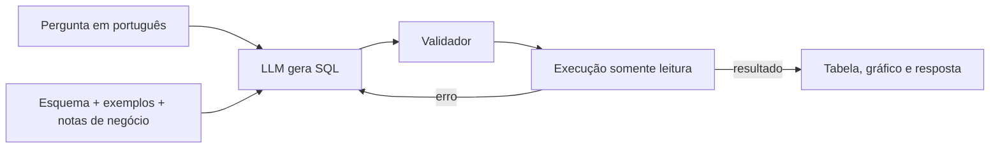

# Pergunte aos dados: agente Text-to-SQL com LLM

Agente que recebe perguntas em português, gera SQL com um LLM, executa a consulta com segurança num banco SQLite e responde em linguagem natural. Os dados são do [dataset público de e-commerce da Olist](https://www.kaggle.com/datasets/olistbr/brazilian-ecommerce): cerca de 100 mil pedidos feitos no Brasil entre 2016 e 2018.

> **Pergunta:** Quais as 5 categorias com maior faturamento?
> **O agente:** gera o SQL, executa, mostra a tabela, desenha o gráfico e resume o resultado em 1 a 3 frases.

<!-- Depois de rodar o app, coloque aqui um GIF ou print:  -->

## Como funciona



1. **Contexto:** o prompt leva o DDL de cada tabela, 3 linhas de exemplo e [notas de negócio](src/text2sql/schema_notes.md), como "faturamento é a soma de `order_items.price`" e "considere só pedidos entregues". Sem essas notas, o modelo inventa definições diferentes a cada pergunta.
2. **Geração:** o LLM devolve só o SQL, com `temperature=0` para ser mais estável.
3. **Autocorreção:** se a consulta falha (coluna inexistente, erro de sintaxe), o erro do SQLite volta para o LLM, que tenta de novo.
4. **Recusa:** se a pergunta não pode ser respondida com os dados ("qual a idade dos clientes?"), o agente diz isso em vez de inventar uma consulta.

### Segurança em 3 camadas

O SQL vem de um modelo, então é tratado como entrada não confiável:

| Camada | Onde | O que faz |
|---|---|---|
| Validador | [`validator.py`](src/text2sql/validator.py) | Aceita só um `SELECT`/`WITH` por vez e recusa `DROP`, `DELETE`, `PRAGMA` etc. A mensagem de erro serve para o LLM se corrigir. |
| Authorizer do SQLite | [`db.py`](src/text2sql/db.py) | O próprio SQLite recusa qualquer operação que não seja leitura, mesmo que passe pelo validador. |
| Arquivo somente leitura | [`db.py`](src/text2sql/db.py) | O banco é aberto com `mode=ro`. Também há limite de linhas e de tempo por consulta. |

## Avaliação

Perguntar "funcionou?" para um agente de IA não basta: é preciso medir. O conjunto [`evals/questions.jsonl`](evals/questions.jsonl) tem 27 perguntas com SQL de referência, incluindo perguntas ambíguas (com mais de uma resposta aceita) e perguntas que o agente deve recusar.

- **Acerto por execução:** o SQL gerado e o de referência são executados e os resultados comparados. Comparar o texto do SQL não funciona, porque há muitas formas certas de escrever a mesma consulta. A comparação aceita colunas em outra ordem, colunas extras e diferenças de arredondamento.
- **Recusas corretas:** perguntas fora do escopo precisam ser recusadas.
- **Latência e tentativas:** média, p95 e quantas vezes a autocorreção foi usada.

```bash
python evals/run_evals.py              # roda tudo e salva os detalhes em evals/results/
python evals/run_evals.py --ids q17    # uma pergunta específica
```

### Resultados

<!-- Preencha com os números que o run_evals.py imprimir. Não invente valores. -->

| Modelo | Acerto | Latência média | p95 | Tentativas (média) |
|---|---|---|---|---|
| _preencher_ | _x/27_ | _s_ | _s_ | _ |

## Como rodar

Requisitos: Python 3.11 ou mais recente e uma chave de API de algum provedor de LLM.

```bash
git clone https://github.com/matheussilveiradev/text-to-sql-olist.git
cd text-to-sql-olist
python -m venv .venv
source .venv/bin/activate        # no Windows: .venv\Scripts\activate
pip install -r requirements.txt
```

**1. Baixe os dados e crie o banco**

```bash
python scripts/download_data.py   # baixa do Kaggle para data/raw
python scripts/build_db.py        # cria data/olist.db
python evals/run_evals.py --check-gold   # confere se o SQL de referência roda nos dados reais
```

Se o download pedir login, baixe o `.zip` na [página do dataset](https://www.kaggle.com/datasets/olistbr/brazilian-ecommerce), extraia os CSVs em `data/raw/` e rode só o `build_db.py`.

**2. Configure o LLM**

Copie `.env.example` para `.env` e preencha `LLM_BASE_URL`, `LLM_API_KEY` e `LLM_MODEL`. O cliente usa o formato da API da OpenAI, então funciona com vários provedores:

| Provedor | `LLM_BASE_URL` |
|---|---|
| Google Gemini | `https://generativelanguage.googleapis.com/v1beta/openai/` |
| Groq | `https://api.groq.com/openai/v1` |
| NVIDIA | `https://integrate.api.nvidia.com/v1` |
| OpenRouter | `https://openrouter.ai/api/v1` |
| Ollama (local, sem chave) | `http://localhost:11434/v1` |
| OpenAI | deixe em branco |

Confira na página de cada provedor os modelos disponíveis, os limites de uso e os preços.

**3. Use**

```bash
streamlit run app.py         # interface web
pytest                       # testes (não precisam de LLM nem do dataset)
```

## Estrutura

```
├── app.py                    # interface Streamlit
├── src/text2sql/
│   ├── agent.py              # fluxo pergunta -> SQL -> execução -> resposta, com autocorreção
│   ├── db.py                 # conexão somente leitura, authorizer, limites de linhas e tempo
│   ├── validator.py          # extrai e valida o SQL vindo do LLM
│   ├── schema.py             # monta o contexto do banco para o prompt
│   ├── schema_notes.md       # definições de negócio usadas no prompt
│   ├── prompts.py            # prompts do agente
│   ├── llm.py                # cliente compatível com a API da OpenAI
│   └── evaluation.py         # comparação de resultados para os evals
├── evals/
│   ├── questions.jsonl       # perguntas com SQL de referência
│   └── run_evals.py          # mede acerto, latência e tentativas
├── scripts/
│   ├── download_data.py      # baixa o dataset do Kaggle
│   └── build_db.py           # CSV -> SQLite com índices
└── tests/                    # pytest com base sintética e LLM falso
```

## Decisões e limitações

- **SQLite** em vez de um banco servidor: o projeto roda em qualquer máquina sem instalar nada além do Python.
- **Esquema inteiro no prompt:** com 8 tabelas cabe tranquilamente. Com centenas de tabelas, seria preciso selecionar as tabelas relevantes antes (por exemplo, com busca por embeddings).
- **A comparação dos evals olha coluna por coluna**, então dois resultados com os mesmos valores trocados entre linhas seriam considerados iguais. É raro nessas perguntas, mas está documentado em [`evaluation.py`](src/text2sql/evaluation.py).
- **27 perguntas são poucas** para conclusões estatísticas. Servem para comparar versões do prompt e modelos diferentes.

## Próximos passos

- [ ] Comparar 2 ou 3 modelos na tabela de resultados
- [ ] Testar exemplos de pergunta e SQL no prompt (few-shot) e medir se o acerto sobe
- [ ] Publicar uma demo online
- [ ] Aumentar o conjunto de avaliação com perguntas mais difíceis

## Dados e licença

Código sob licença MIT. O dataset é da Olist, distribuído no Kaggle sob [CC BY-NC-SA 4.0](https://creativecommons.org/licenses/by-nc-sa/4.0/), e não faz parte deste repositório.
